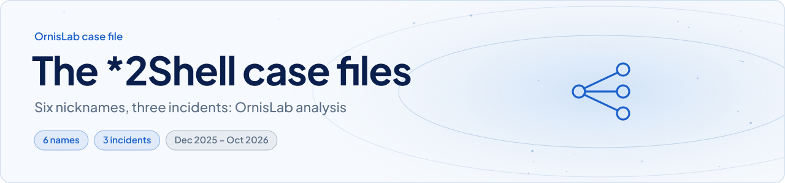
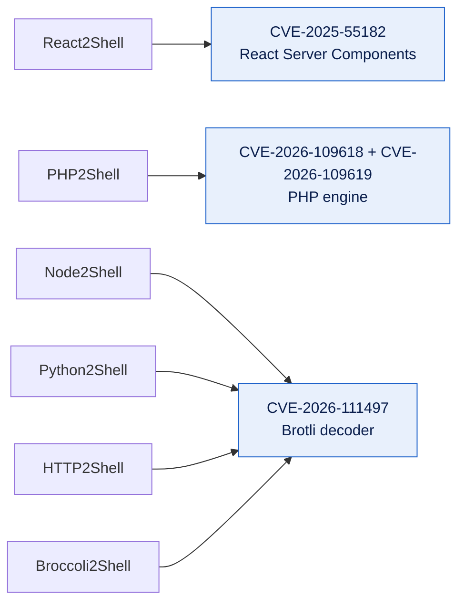
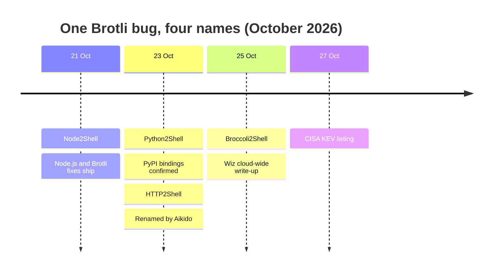

# The *2Shell vulnerabilities: OrnisLab case files

Between December 2025 and October 2026, six vulnerability nicknames ending in "2Shell" spread through security news. Behind them are only three incidents. This repository is OrnisLab's analysis of each one: what broke, how it surfaced, how attackers used it, what investigators found on compromised systems, and what defenders should do.

> [!IMPORTANT]
> Node2Shell, Python2Shell, HTTP2Shell and Broccoli2Shell are one bug: **CVE-2026-111497**, an out-of-bounds write in Google's Brotli decoder. Count it once in your risk register, but patch it everywhere the decoder lives.

## Name map

| Nickname | CVE | Where the bug is | Disclosed | Exploited | Case file |
| :-- | :-- | :-- | :-- | :-- | :-- |
| **React2Shell** | CVE-2025-55182 (Next.js: CVE-2025-66478) | React Server Components payload decoding | 3 Dec 2025 | Yes, CISA KEV 5 Dec 2025 | [react2shell](react2shell/README.md) |
| **PHP2Shell** | CVE-2026-109618, CVE-2026-109619 | PHP engine memory safety | 21 Oct 2026 (leaked 20 Oct) | Yes, CISA KEV 27 Oct 2026 | [php2shell](php2shell/README.md) |
| **Node2Shell** | CVE-2026-111497 | Brotli decoder, Node.js view | 21 Oct 2026 | Yes, CISA KEV 27 Oct 2026 | [node2shell](node2shell/README.md) |
| **Python2Shell** | CVE-2026-111497 | Brotli decoder, PyPI view | 23 Oct 2026 | Same CVE | [python2shell](python2shell/README.md) |
| **HTTP2Shell** | CVE-2026-111497 | Brotli decoder, HTTP-stack view | 23 Oct 2026 | Same CVE | [http2shell](http2shell/README.md) |
| **Broccoli2Shell** | CVE-2026-111497 | Brotli decoder, cloud-inventory view | 25 Oct 2026 | Same CVE | [broccoli2shell](broccoli2shell/README.md) |

### How one bug got four names

The Brotli flaw was renamed each time its reach grew. It was **Node2Shell** on 21 October, when Node.js shipped the fix. Two days later, once Python packages were confirmed affected, people started calling it **Python2Shell**. Late the same day Aikido proposed **HTTP2Shell**, arguing the problem belonged to the HTTP layer rather than any one runtime. Wiz's 25 October write-up called it **Broccoli2Shell**, and "Brotli2Shell" also circulated. We keep a page per name because each name now leads people to a different part of the problem. The four pages are written so they do not repeat each other:

| Page | Owns |
| :-- | :-- |
| Node2Shell | Root cause, disclosure timeline, Node.js exposure |
| Python2Shell | Transitive dependencies and the Python ecosystem |
| HTTP2Shell | Fixed versions across stacks, attack traffic and the WAF blind spot |
| Broccoli2Shell | Finding hidden copies of the decoder and deciding what to fix first |

## What the three incidents have in common

**The vulnerable code was nobody's direct choice.** Teams picked Next.js, WordPress or Express. React's wire format, PHP's memory allocator and a compression library came along without a decision. Asset inventories built from what teams *chose* missed all three.

**Exposure was set by defaults, not by application code.** A React app did not need its own Server Functions. A PHP site did not need upload progress bars. A Python service did not need to import Brotli. In each case the vulnerable path was switched on before any developer wrote a line.

**The patch window was measured in hours.** React2Shell was exploited the day it was disclosed. PHP2Shell was probed four days *before* disclosure. Exploitation of the Brotli flaw was confirmed within a week, and probing began within a day.

**AI changed the economics on both sides.** PHP2Shell and the Brotli flaw were both found by AI-assisted code review in 2026. The same tools shorten the path from a patch diff to a working exploit.

**Hardened runtimes made the difference.** The only detailed public post-compromise investigation (React2Shell) shows an attacker with code execution failing at almost every next step because the container lacked a shell, download tools and sudo. Of all the controls in these files, it worked the most consistently across all three incidents.

## Page outline

Each case file covers: a summary table, the root cause, discovery and disclosure, exploitation, forensic findings, detection, remediation, and an **OrnisLab assessment** with our own conclusions for defenders. Brotli pages link to each other instead of repeating shared material.

## Disclaimer

These files reflect public reporting and OrnisLab's analysis as of **21 November 2026**. Findings attributed to a named organization are that organization's; where reports disagreed, we say so. Indicators of compromise are defanged and may belong to shared or reassigned infrastructure, so validate before blocking. The files contain no exploit code, and nothing here may be used against systems you are not authorized to test.

## Contributing

Corrections are welcome. Open an issue or pull request that points to the vendor advisory, CVE record or primary research the correction relies on.

## License

The case files, text and images in this repository are licensed under [CC BY 4.0](LICENSE).
---

**[OrnisLab](https://github.com/OrnisLab)**: Open Research Network for Intelligent Security

The *2Shell case files: React2Shell, PHP2Shell and CVE-2026-111497 
OrnisLab case file, last reviewed on 21 November 2026

For more detail on the Ornis cybersecurity platforms, visit **[ornis.com.tr](https://ornis.com.tr)**

<a href="https://github.com/OrnisLab/2shell-advisories">All case files</a> &nbsp;|&nbsp; <a href="https://github.com/OrnisLab/.github/blob/main/SECURITY.md">Security policy</a> &nbsp;|&nbsp; <a href="https://github.com/OrnisLab/.github/blob/main/CONTRIBUTING.md">Contribute</a> &nbsp;|&nbsp; <a href="https://www.isnet.net.tr">isnet.net.tr</a>

OrnisLab is maintained by İşNet (İş Net Elektronik Bilgi Üretim Dağıtım Ticaret ve İletişim Hizmetleri A.Ş.), headquartered in İstanbul, Türkiye. Each project is released under the license in its own repository.

