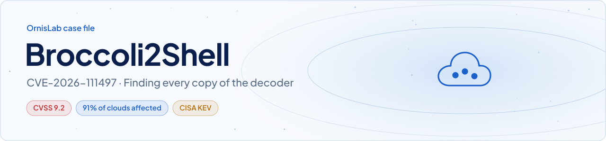
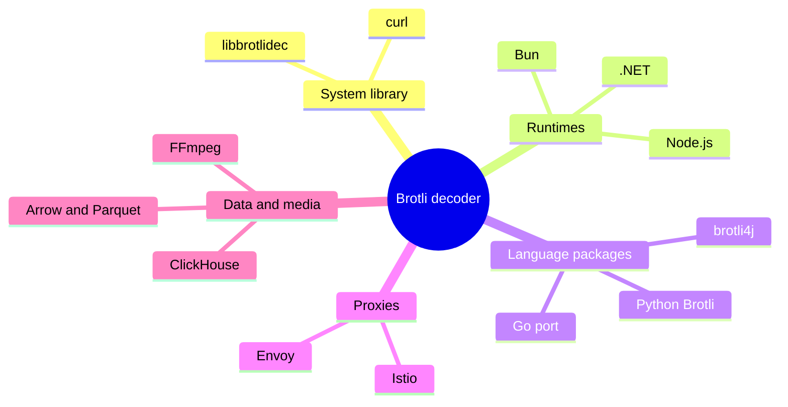
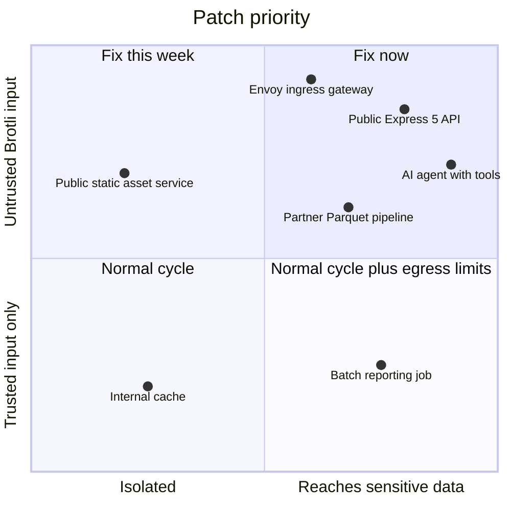

# Broccoli2Shell (CVE-2026-111497)

Broccoli2Shell is Wiz's name for the Brotli decoder flaw, and its write-up looked at the whole cloud estate rather than one runtime. The question on this page is the hardest part of responding to CVE-2026-111497: **where are all the copies of the decoder, and which ones should you fix first?**

> [!NOTE]
> Root cause and timeline: [Node2Shell](../node2shell/README.md). Python: [Python2Shell](../python2shell/README.md). Fixed versions and attack traffic: [HTTP2Shell](../http2shell/README.md).

## At a glance

| Field | Details |
| :-- | :-- |
| **CVE / advisories** | CVE-2026-111497, GHSA-9v8h-qqgm-4m35, Wiz advisory wiz-adv-2026-191 |
| **Named** | Wiz, 25 October 2026; also seen as "Brotli2Shell" |
| **Cloud reach (Wiz)** | Vulnerable resources in 91% of cloud environments; publicly exposed Node.js in 82% |
| **Credits** | Discovery: Khai Tran, Sylvie Mayer (OpenAI Codex Security). Node.js fix: Matteo Collina, Antoine du Hamel. Exploitability: Ron Masas (Imperva). Python impact: OpenSourceMalware, Aikido |

## Why inventory is the hard part

Brotli is not a dependency in the usual sense. It is copied: compiled into runtimes, vendored into native packages and statically linked into tools. Semgrep put it this way: the bug belongs to no single ecosystem, only to one decoder that was copied many times. Every copy is patched separately.

| Where it lives | Examples | Shows up in package lists? |
| :-- | :-- | :-- |
| System shared library | `libbrotlidec` (used by curl and others) | Yes |
| Language runtime binary | Node.js, Bun, .NET | No, it is inside the runtime |
| Native language packages | Python `Brotli`, `brotlicffi`; Java `brotli4j` | As the package, not as Brotli |
| Ported code | Go `andybalholm/brotli` | As a Go module |
| Proxies and meshes | Envoy, Istio sidecars | No |
| Data and media software | Arrow and Parquet readers, ClickHouse, FFmpeg, JPEG XL, PDF and archive tools | Rarely |
| Security and build tools | cdxgen and similar | Rarely |

So an `apt upgrade` patches the first row and none of the others. A host can show "brotli: fixed" while running a vulnerable Node.js binary, Python wheel and Envoy sidecar.

## Finding the copies

| Method | Finds | Misses |
| :-- | :-- | :-- |
| OS package queries (`dpkg`, `rpm`, `apk`) | System library | Everything bundled |
| `grep -l brotlidec /proc/*/maps` | Running processes using the shared library | Static copies, stopped workloads |
| Language manifests and lockfiles | Python, Java, Go packages | Runtime-bundled copies |
| Runtime version checks (`node -p process.versions.brotli`, `dotnet --list-runtimes`) | Runtime copies | Third-party binaries |
| SBOM and image scanning with binary analysis | Most of the above, including static copies | Images never scanned |
| Cloud security graph queries (e.g. Wiz's pre-built query) | Estate-wide view with exposure context | Assets outside the platform |

No single method covers everything, so combine at least one row that sees bundled copies (SBOM with binary analysis) with one that sees running state (`/proc` or runtime checks).

## Deciding what to fix first

When a fleet has hundreds of affected components, patch order matters. We rank them on two questions: **can an attacker get Brotli data into this component?** and **what does this component reach?**

| | Reaches sensitive data or internal networks | Isolated |
| :-- | :-- | :-- |
| **Takes untrusted Brotli input** (public `br` endpoints, fetches user-chosen URLs, reads partner files) | Fix now | Fix this week |
| **Only trusted input** | Fix in normal cycle; restrict egress | Fix in normal cycle |

Concrete "fix now" examples: internet-facing Express 5 APIs inside a VPC, AI agents with access to internal tools, data pipelines that read partner-supplied Parquet into a warehouse, and Envoy ingress gateways with request decompression enabled.

## Exploitation and cloud forensics

The exploitation record for this CVE is documented once, in [HTTP2Shell](../http2shell/README.md#attack-traffic). From a cloud investigation point of view, three signals stand out:

- **Exit code 139.** In Kubernetes, pods restarting with exit code 139 (segmentation fault) in services that handle compressed data should be investigated, not written off as instability.
- **Image age.** Workloads built before 21 October almost certainly contain a vulnerable copy, whatever the node's patch level. Image build dates make a quick first filter.
- **Internal blast radius.** The outbound path means services with no public listener can still be attacked, through the URLs and files they fetch. Scope an investigation by data flows, not just by internet exposure.

No public report of a confirmed cloud compromise through this CVE has been published.

## Remediation

1. Build the inventory using at least two complementary methods from the table above.
2. Rank findings with the priority matrix and fix the "now" quadrant first.
3. Patch each copy separately (versions: [HTTP2Shell](../http2shell/README.md#fixed-versions-across-stacks)), then rebuild images, roll workloads and verify the loaded version.
4. While patches roll out, disable Brotli decompression where it is not needed and restrict egress from fetch-heavy services.
5. Review crash data, egress logs and WAF logs from 21 October onward.

## OrnisLab assessment

**SBOMs that only read manifests missed this bug.** CVE-2026-111497 is the clearest recent case of a vulnerability hidden in binaries. Manifest-based inventories reported most affected services as clean. Treat binary-level composition analysis as a requirement for runtime and base images.

**Patch status belongs to each copy, not to each host.** Tracking per host ("is this VM patched?") gave false confidence throughout this incident. Track per component instead: each runtime, sidecar and native package in each image.

**This will happen again.** Compression, image, font and parsing libraries share the same profile: written in C, copied everywhere, and fed untrusted input by design. Building the Broccoli2Shell inventory once, and keeping it current, prepares an organization for the next decoder bug as much as for this one.
