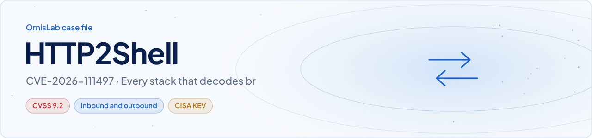
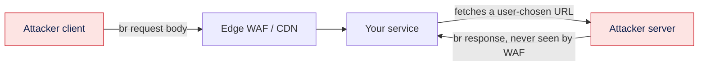
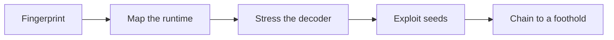

# HTTP2Shell (CVE-2026-111497)

HTTP2Shell treats the Brotli decoder flaw as what it became: a problem for every HTTP component that understands `Content-Encoding: br`. That includes runtimes, clients, proxies and service meshes, and attacks can arrive on either side of a connection. This page owns the cross-stack fixed-version table, the observed attack traffic, and the reason perimeter defenses only cover half the problem.

> [!NOTE]
> Despite the name, this is not an HTTP/2 protocol bug. Root cause and timeline: [Node2Shell](../node2shell/README.md). Python: [Python2Shell](../python2shell/README.md). Inventory and prioritization: [Broccoli2Shell](../broccoli2shell/README.md).

## At a glance

| Field | Details |
| :-- | :-- |
| **CVE / advisories** | CVE-2026-111497, GHSA-9v8h-qqgm-4m35, JPCERT/CC AT260034 |
| **Severity** | CVSS v4.0 9.2; Microsoft: Critical (.NET, Visual Studio), Important (PowerShell) |
| **Name origin** | Aikido, 23 October 2026; adopted in Bun's advisory the next day |
| **Exploited** | Yes; CISA KEV on 27 October 2026, federal deadline 10 November |

## Fixed versions across stacks

| Component | Fixed in | Notes |
| :-- | :-- | :-- |
| Brotli (`libbrotlidec`) | 1.0.10, 1.1.1, 1.2.1 | Distributions backport; check your vendor |
| Node.js | 22.23.4, 24.22.1, 26.12.1 | 20 and earlier, 23 and 25 stay vulnerable |
| Bun | 1.4.4 | Vulnerable from 1.0.21 |
| Python `Brotli` / `brotlicffi` | 1.2.1 / 1.2.1.0 | |
| .NET | 8.0.33, 9.0.22, 10.0.14, 11 RC3 | Out-of-band release on 25 October; .NET Framework unaffected |
| Envoy | 1.36.12, 1.37.8, 1.38.6, 1.39.3, 1.40.0 | |
| Istio | 1.29.9, 1.30.6, 1.31.2 | Bundles Envoy |
| Go `andybalholm/brotli` | v1.2.7 | Go port of the decoder |

Java `brotli4j`, FFmpeg, Apache Arrow, ClickHouse and cdxgen also carry the decoder. At the time of writing, some bundled copies in PHP and Ruby extensions were still waiting on fixes.

## Two directions, one decoder



| | Inbound | Outbound |
| :-- | :-- | :-- |
| **Who sends the Brotli data** | A client sending a request to your service | A server your service fetches from |
| **Typical components** | Express 5, ASP.NET Core request decompression, Envoy decompressor filters | Node.js `fetch()`, Python HTTP clients, libcurl on Debian 12 and Ubuntu 24.04 |
| **Who decides where traffic goes** | The attacker picks your endpoint | Often your user picks the URL |
| **Seen by edge WAF or CDN** | Yes | No |
| **Fastest stopgap** | Reject `br` request bodies at the edge | Disable `br` in clients; restrict egress |

Default Apache and Nginx do not decode Brotli request bodies, so the inbound column depends on the framework and proxy configuration, not on the web server.

## Attack traffic



**First 24 hours (Zscaler).** 402 events from 20 IPs against 12 customers, about 40% reconnaissance and 60% exploitation attempts. The payloads fall into a clear progression:

| Stage | Payload shape | Intent |
| :-- | :-- | :-- |
| Fingerprint | 1-byte malformed vs. valid Brotli, compared | Does the target decode `br`? (attributed to Assetnote scanning) |
| Fingerprint | 14-byte `{"ping":1}` compressed, compared | Same, against JSON APIs |
| Map | Malformed headers plus Node.js path probes | Which runtime is behind the endpoint? |
| Stress | Truncated JSON with invalid padding; decompression bomb or Celery stream | How does the decoder fail? |
| Exploit | 22- and 23-byte invalid block-switch seeds | Trigger the out-of-bounds write |
| Chain | Three-stage capability probe plus a Strapi probe | Turn a write into a foothold |

**First week.** Strobes reported no confirmed real-world attacks on 24 October, and the public PoC only crashed standard builds. The same week, Imperva showed code execution on an official Node.js build. On 26 October, ELLIO recorded the public exploit in live traffic from 94.154.43[.]7, an address it had previously tied to PHP2Shell, VPN-appliance probing and Kubernetes API scanning. CISA listed the CVE the following day.

**Source IPs (defanged).** Zscaler: 49.37.46[.]99, 34.10.240[.]142, 188.245.184[.]87, 52.46.50[.]66, 136.111.197[.]96. ELLIO: 94.154.43[.]7.

## Forensic notes

No published incident response has confirmed a compromise through this CVE. What the traffic above means for investigators:

- **Look for pairs.** Recon arrived as matched requests, one malformed and one valid, sent to the same endpoint seconds apart. In proxy logs, two `br` requests with very different tiny body sizes are a strong signal.
- **Body size is a feature.** Real Brotli-compressed request bodies are rare and rarely below 30 bytes. Bodies of 1 to 23 bytes with `Content-Encoding: br` should be treated as hostile by default.
- **Sidecars count.** In service meshes, the crash may be in Envoy rather than the application. Check sidecar restarts, not only application containers.

## Detection

```bash
dpkg -l | grep -i brotli; rpm -qa | grep -i brotli; apk info -v | grep -i brotli
sudo grep -l brotlidec /proc/*/maps
dotnet --list-runtimes
envoy --version; istioctl version
```

Rules to add:

1. Proxy and WAF: `Content-Encoding: br` on requests with bodies under 32 bytes.
2. Proxy and WAF: paired `br` requests to one endpoint from one source within a short window.
3. Hosts: crashes in Node.js, Bun, Python, .NET or Envoy processes, followed by child processes or new outbound connections.

## Remediation

1. Patch every component in the table that you run, including mesh sidecars and base images.
2. At the edge, reject `br` request bodies wherever no legitimate client sends them.
3. For outbound traffic, disable `br` in clients that fetch untrusted URLs and put fetch-heavy services behind an egress proxy with an allowlist.
4. Test compatibility before rollout, since a few upstream services only respond with Brotli.

## OrnisLab assessment

**Perimeter controls only cover the inbound half.** WAF and CDN rules were the first response for most teams, and they only see inbound requests. The outbound direction (your service fetching a hostile response) never reaches them. A complete HTTP2Shell response needs egress control as well.

**The name was misleading.** "HTTP2Shell" led some teams to check their HTTP/2 configuration and stop there. Because a name now travels faster than the advisory, we recommend triaging by CVE number, never by nickname.

**Reconnaissance was well organized.** Differential probing, runtime fingerprinting and staged chaining within one day suggest that scanning operators had tooling ready before disclosure. Expect the same speed for the next library-level bug.
