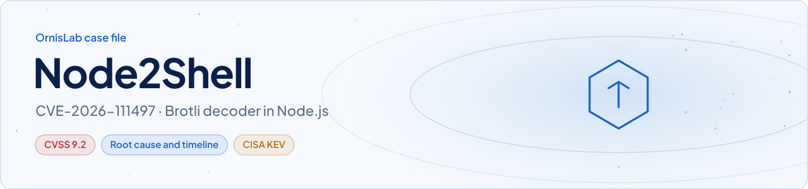
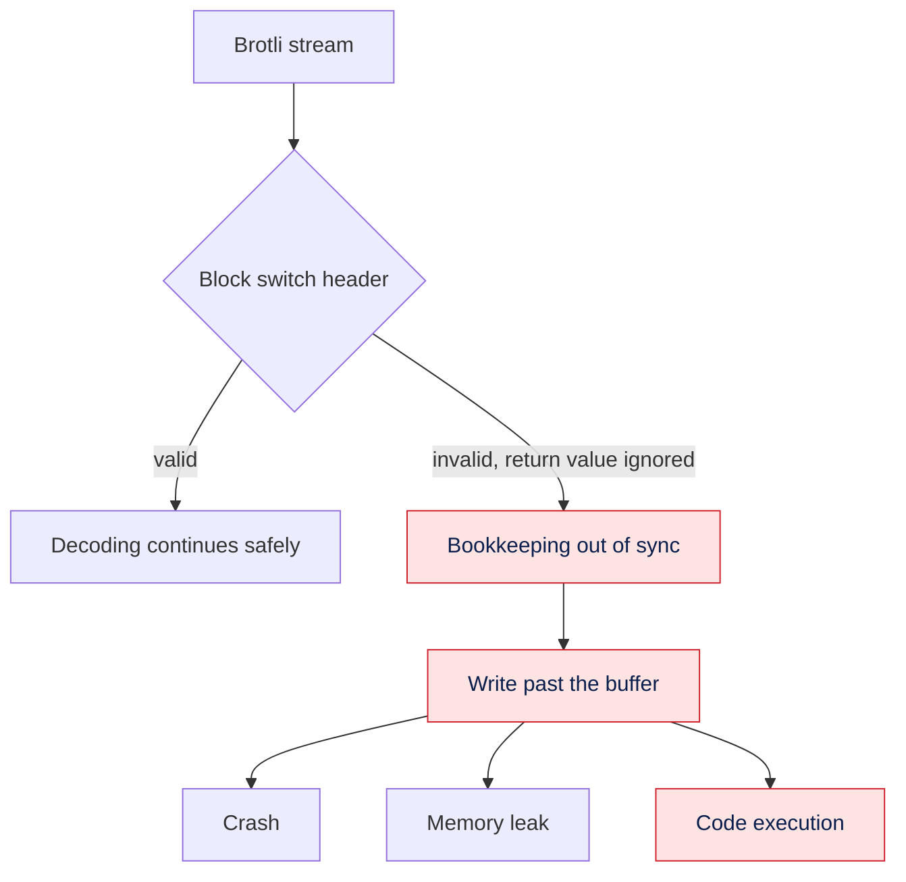
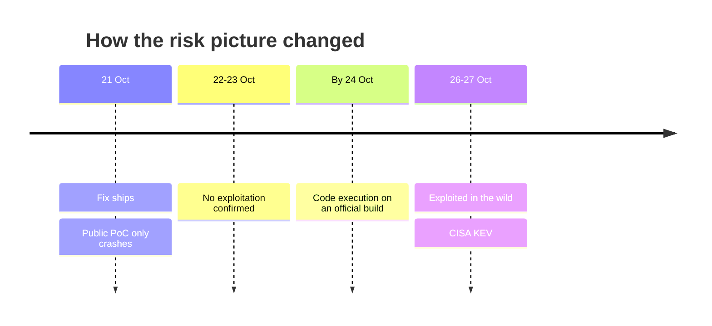
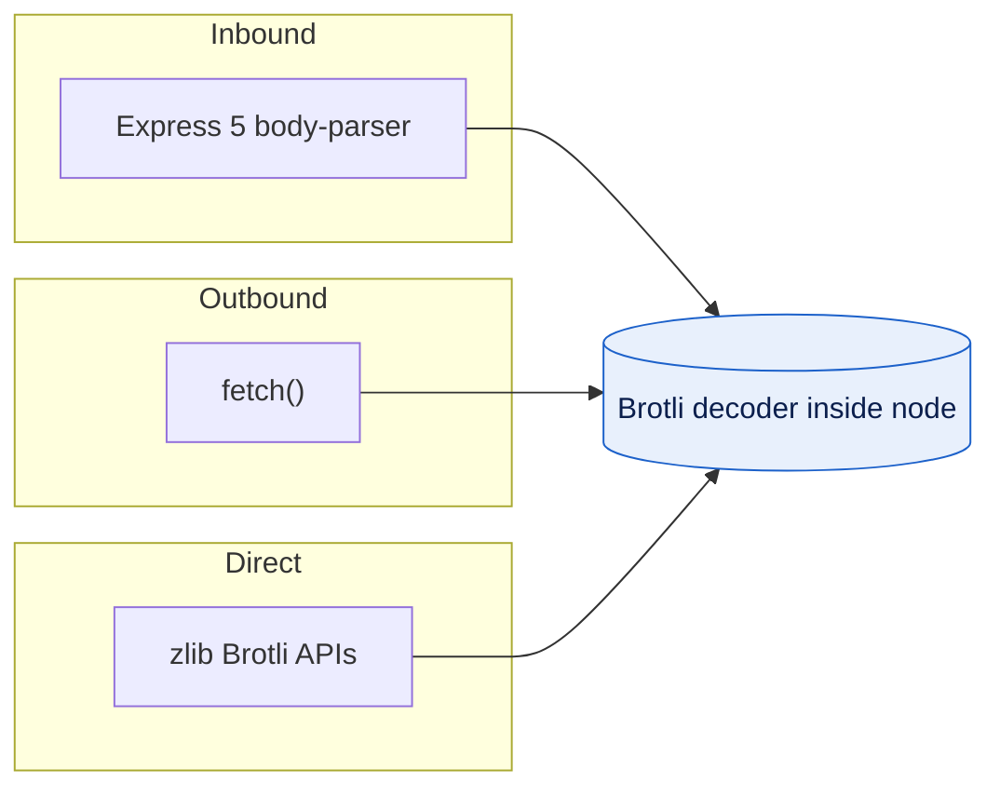

# Node2Shell (CVE-2026-111497)

Node.js compiles Google's Brotli decoder into its own binary. A malformed Brotli stream could make that decoder write outside its buffer, and any Node.js code path that inflates attacker-supplied data could trigger it. This page owns the root cause and the disclosure story for CVE-2026-111497, and covers the Node.js exposure in detail.

> [!NOTE]
> Same CVE, other angles: [Python2Shell](../python2shell/README.md) (PyPI and transitive dependencies), [HTTP2Shell](../http2shell/README.md) (fixed versions across stacks and attack traffic), [Broccoli2Shell](../broccoli2shell/README.md) (finding every copy of the decoder).

## At a glance

| Field | Details |
| :-- | :-- |
| **CVE / advisory** | CVE-2026-111497, GHSA-9v8h-qqgm-4m35 |
| **Severity** | CVSS v4.0 9.2 (Google as CNA); Node.js rates it high |
| **Weakness** | CWE-787, caused by CWE-252 |
| **Upstream** | Brotli 1.0.3–1.2.0 vulnerable; fixed in 1.0.10, 1.1.1, 1.2.1 |
| **Node.js fixed** | 22.23.4, 24.22.1, 26.12.1 |
| **Never fixed** | Node.js 20 and earlier, 23, 25 |
| **Credit** | Khai Tran and Sylvie Mayer, OpenAI Codex Security |
| **Exploited** | Yes; CISA KEV on 27 October 2026 |

## Root cause



A Brotli stream is a sequence of blocks, and the decoder changes block type as it reads. Changing type means reading a small header with `DecodeBlockTypeAndLength`. In the decoder's fast path, a macro called that function but ignored its return value. If the header was invalid, decoding carried on anyway, with block bookkeeping that no longer matched the buffers, and the next writes landed outside the intended memory and corrupted neighboring decoder state.

The upstream fix is small: a malformed block switch now ends decoding with its own error code. That fix size is typical of CWE-252 bugs, where one ignored check can turn into memory corruption.

What an attacker gets depends on the host program: a crash in most cases, sometimes a memory leak, and code execution when heap layout cooperates.

## Disclosure



| Date (2026) | Event |
| :-- | :-- |
| Before 21 Oct | OpenAI Codex Security reports the flaw; Google Brotli and Node.js coordinate a fix |
| 21 Oct | Brotli and Node.js releases ship (Node.js at 10:38 UTC); Matteo Collina and Antoine du Hamel land the Node.js changes |
| 21–22 Oct | A public PoC appears; it crashes stock Node.js and only gets code execution on weakened builds |
| 22–23 Oct | Aikido and Sysdig report no confirmed exploitation |
| By 24 Oct | Imperva's Ron Masas gets code execution on the official Node.js 24.22.0 arm64 build via `fetch()` and Express 5, after several attempts |
| 26–27 Oct | Exploitation confirmed in the wild; CISA KEV with a 10 November federal deadline |

The gap between "the PoC only crashes" and "code execution on an official build" was about three days. Organizations that ranked the bug as denial-of-service on 22 October had to re-rank it within the week.

## Node.js exposure



Node.js is only at risk when attacker-controlled Brotli data reaches the decoder at runtime. A site that uses Node.js only at build time is not exposed in production.

| Path | Example | Exposed by default? |
| :-- | :-- | :-- |
| Request bodies | Express 5.0–5.3 via body-parser 2.0–2.3 | Yes, `express.json()` inflates `br` |
| Request bodies | Express 4 | No, returns 415, unless other middleware decodes `br` |
| Fetched responses | Built-in `fetch()` | Yes, transparent `br` decoding |
| Direct calls | `zlib.brotliDecompress()` on uploads, caches, queues | When code feeds it untrusted data |
| Other runtimes | Bun 1.0.21 to 1.4.3 | Fixed in 1.4.4 |

The `fetch()` row deserves most attention. A webhook validator, link unfurler or AI browsing tool that fetches a URL chosen by a user also accepts whatever compressed response that URL sends back.

## Exploitation and forensics

Zscaler saw probes and exploitation attempts within the first day, and ELLIO confirmed working exploits in the wild before CISA's listing; [HTTP2Shell](../http2shell/README.md#attack-traffic) covers that traffic. No public investigation of a confirmed Node.js compromise exists yet.

For Node.js responders, the most likely evidence is in this order:

1. **Crash records.** `SIGSEGV` or `SIGBUS` exits, core dumps, and process-manager restarts (pm2, systemd, Kubernetes) shortly after requests carrying `Content-Encoding: br`.
2. **Process lineage.** The Node.js process spawning `sh`, `curl` or `wget` soon after a crash and restart cycle.
3. **Egress.** New outbound connections from the Node.js service, especially from fetch-heavy features.

Imperva needed several attempts on an official build, so a cluster of crashes followed by unusual behavior is what exploitation would most likely look like. A single crash on its own is much less telling.

## Detection

```bash
node --version
node -p "process.versions.brotli"          # bundled decoder version
npm ls express body-parser
grep -rnE "express\.json|bodyParser|brotliDecompress|createBrotliDecompress|fetch\(" src/
bun --version
```

## Remediation

1. Move to Node.js 22.23.4, 24.22.1 or 26.12.1 (Bun 1.4.4). End-of-life lines need a migration, not a patch.
2. Rebuild images, redeploy, and confirm `process.versions.brotli` reports a fixed decoder.
3. Until then, reject `br` request bodies, turn off Brotli decoding in outbound clients where possible, and limit egress from fetching services. Edge filtering does not protect `fetch()`.

## OrnisLab assessment

**The outbound path is the one teams will miss.** Most early guidance focused on request bodies, which WAFs and reverse proxies can filter. Our view is that the higher long-term risk lies in services that fetch content: webhooks, integrations, crawlers and especially AI agents. Their traffic never passes the edge and their destinations are chosen by users.

**End-of-life Node.js is now a concrete risk.** Many production fleets still run Node.js 20, 23 or 25, and those lines will never get a fix. Node2Shell is a good reason to finish those migrations.

**Severity scores diverged.** Google scored 9.2, while Node.js rated the issue high. Teams that read only their runtime's advisory may have deprioritized it, so for shared libraries, check the upstream CNA's score as well.

---

<div align="center">

<a href="https://github.com/OrnisLab"></a>

**[OrnisLab](https://github.com/OrnisLab)**: Open Research Network for Intelligent Security

Node2Shell (CVE-2026-111497), Brotli decoder flaw in Node.js<br>
OrnisLab case file, last reviewed on 21 November 2026

For more detail on the Ornis cybersecurity platforms, visit **[ornis.com.tr](https://ornis.com.tr)**

<a href="https://github.com/OrnisLab/2shell-advisories">All case files</a> &nbsp;|&nbsp; <a href="https://github.com/OrnisLab/.github/blob/main/SECURITY.md">Security policy</a> &nbsp;|&nbsp; <a href="https://github.com/OrnisLab/.github/blob/main/CONTRIBUTING.md">Contribute</a> &nbsp;|&nbsp; <a href="https://www.isnet.net.tr">isnet.net.tr</a>

<sub>OrnisLab is maintained by İşNet (İş Net Elektronik Bilgi Üretim Dağıtım Ticaret ve İletişim Hizmetleri A.Ş.), headquartered in İstanbul, Türkiye. Each project is released under the license in its own repository.</sub>

</div>
