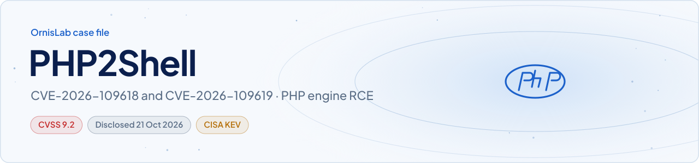
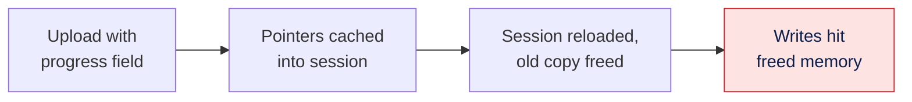
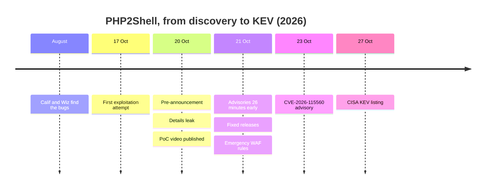
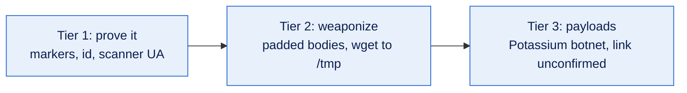

# PHP2Shell (CVE-2026-109618, CVE-2026-109619)

Two memory-safety bugs in the PHP interpreter allowed unauthenticated code execution on almost every PHP version in use. The flaws themselves were serious. What made PHP2Shell memorable was everything around them: AI-assisted discovery, a disclosure that leaked a day early, exploitation that started before any warning, and governments taking websites offline.

## At a glance

| Field | Details |
| :-- | :-- |
| **CVEs** | CVE-2026-109618 (out-of-memory corruption), CVE-2026-109619 (stale session state) |
| **Severity** | CVSS v4.0 9.2 each (PHP); watchTowr scores 10.0 |
| **Vulnerable** | PHP 5.4 through 8.5, every release before the October 2026 fixes |
| **Fixed** | 8.5.12, 8.4.27, 8.3.36, 8.2.35; source patches for 7.4, 8.0, 8.1 |
| **Riskiest setups** | Apache mod_php first; also PHP-FPM, php-cgi, FrankenPHP, LiteSpeed, and products with bundled PHP |
| **Credit** | Ryan Austin (Calif); found independently by Wiz, which named it |
| **Exploited** | Yes; first attempt 17 October 2026; CISA KEV on 27 October 2026 |

## Root cause



**CVE-2026-109619: pointers that outlive their data.** By default, PHP tracks file-upload progress in the session. While doing so, it keeps direct pointers into session data. A later progress update reloads the session into fresh memory and frees the old copy, but the saved pointers still point at the freed memory. Writing through them corrupts memory in a way an attacker can steer. This all runs before the application's own code, so any URL that accepts multipart uploads is a target, even if the application never reads the file.

**CVE-2026-109618: an exit that skips the cleanup.** When a request exceeds `memory_limit`, PHP jumps directly to request shutdown. The jump bypasses normal cleanup, so shutdown can find internal structures that are half-built or already freed, and may call function pointers stored in them.

**The catch for attackers.** Reliable exploitation needs a memory offset that is specific to each PHP build, either leaked from the target or derived from the exact binary. That rules out a single universal exploit, but attackers can get around it by fingerprinting the target's distribution and PHP build first.

**A third, narrower flaw.** CVE-2026-115560 (advisory of 23 October) needs upload progress enabled *and* an application that switches the session serializer to `php` at runtime.

## Discovery and disclosure



Ryan Austin of Calif found both bugs in August 2026 while auditing PHP for OpenAI's "Patch the Planet" effort with GPT-5.6 Sol. Wiz arrived at the same bugs independently with a mix of commercial models and its own tooling. One of the underlying behaviors had already been noticed in a 2024 PHP audit; it stayed unfixed because no exploit was known and the fix was disputed.

| Date (2026) | Event |
| :-- | :-- |
| August | Independent discovery by Calif and Wiz |
| 17 Oct | Amazon honeypots log the first known exploitation attempt |
| 20 Oct | php.net pre-announcement; CVE details surface on Hacker News; a proof-of-concept video is published by mistake |
| Before 21 Oct | Early patched builds from one vendor allow attackers to diff the fix |
| 21 Oct | Advisories go live 26 minutes ahead of schedule; fixed releases; Cloudflare ships WAF rules for all plans |
| 22 Oct | Hosting-panel and LTS vendors ship backports |
| 23 Oct | Advisory for CVE-2026-115560 |
| 27 Oct | CISA KEV |

## Impact

Many operators decided that being offline was safer than being unpatched. Wikimedia disabled Phabricator, the Internet Archive briefly went dark, and several large Japanese commerce and gaming sites paused service. Following CERT-EU and UK NCSC guidance, government portals in the Netherlands, Denmark, Finland and France went offline, as did some Canadian government sites. The NSA advised taking unpatchable sites offline; the NCSC told organizations to hunt for backdoors. A month later Censys still counted more than half of roughly 50 million exposed PHP servers as unpatched.

## Exploitation

| Observer | What they reported |
| :-- | :-- |
| Amazon | One attempt on 17 October, before any public information |
| Cloudflare | Early exploitation signals ahead of the release |
| watchTowr | Honeypot hits by 21 October |
| Arctic Wolf | Wide scanning and exploit validation after disclosure |
| SOCRadar | A weaponized toolkit on an extortion group's exposed server |
| ELLIO | An IP used for PHP2Shell (94.154.43[.]7) later used for the Brotli flaw |

Early reports disagreed on how much of this traffic was real exploitation rather than scanning. CISA saw none on 21 October and added the CVEs to KEV six days later.

## Forensic findings



No full incident-response case of a confirmed PHP2Shell compromise has been published. Arctic Wolf's traffic analysis is the best evidence available. We group what it describes into three tiers:

**Tier 1: proving the target is vulnerable.** Harmless markers that show up in the response, a call to `id`, and a scanner that announced itself as `php2shell-scan/109618`. Some requests mixed in old session-poisoning and file-inclusion tricks under the new name.

**Tier 2: weaponized attempts.** Requests from 92.118.112[.]100 ran `id` and `uname`, moved to `/tmp` and fetched second stages with `wget`. The request bodies were heavily padded, which fits with attempts to shape memory for the corruption bugs. Another request used a Monolog deserialization gadget to fetch a file called `cCmono` from 45.115.26[.]26.

**Tier 3: the payload ecosystem.** Arctic Wolf examined the Mirai-derived **Potassium** botnet (ARM and x86-64 builds, 24 flood methods, dormant code to find its servers through Ethereum Name Service). It stressed that its telemetry did not show PHP2Shell requests running these samples, so treat the link as circumstantial.

**Indicators (defanged, from Arctic Wolf):** 92.118.112[.]100, 45.198.224[.]169, 5.175.189[.]76, 45.115.26[.]26; payload names `nfs-setup`, `mountpoint`, `cCmono`.

## Detection

```bash
php -v
php-fpm8.3 -v              # repeat for each FPM version in use
dpkg -l | grep -E '^ii\s+php'
rpm -qa | grep -i '^php'
```

The CLI binary and the web server's PHP can differ. Confirm the version the web server actually loads.

High-signal hunts:

1. PHP workers spawning `sh`, `id`, `uname`, `wget` or `curl`.
2. Multipart requests carrying the upload-progress field to endpoints that have no progress bar, especially with oversized, padded bodies.
3. Worker crashes and "memory size exhausted" errors that cluster around a single client.
4. New PHP files in writable or upload directories since 17 October 2026.
5. The scanner user agent and the indicators above.

Patching removes the vulnerability but not anything an attacker left behind before the update. Hunt as well as patch.

## Remediation

1. Upgrade to a fixed release or your vendor's backport; migrate 7.x and 8.0–8.1 if you cannot get backports.
2. Restart every PHP worker. Running FPM and mod_php processes keep the old code until they restart.
3. Stopgaps only, and PHP itself calls them incomplete:
   - `session.upload_progress.enabled = 0` blocks the confirmed CVE-2026-109619 path and CVE-2026-115560. Consider keeping it off permanently if you do not use upload progress bars.
   - `memory_limit = -1` with a small `post_max_size` addresses CVE-2026-109618 but removes PHP's memory cap, so enforce one with cgroups or the container instead.
4. Hunt for web shells and second-stage downloads on every server that was exposed.

## OrnisLab assessment

**The disclosure failed in stages.** First came a public heads-up, then leaked details, an accidental video, and early builds that let attackers diff the fix. None of these alone was fatal; together they gave attackers about a day of head start on most defenders. The takeaway for coordinated disclosure is that patched binaries are a disclosure in themselves. Early access for distributors needs the same embargo discipline as the advisory text.

**Exploitation before disclosure changes the response question.** With an attempt on 17 October, "are we patched?" was never enough. Any PHP server exposed in mid-October should be treated as potentially compromised until someone has looked for web shells and unexpected processes.

---

<div align="center">

<a href="https://github.com/OrnisLab"></a>

**[OrnisLab](https://github.com/OrnisLab)**: Open Research Network for Intelligent Security

PHP2Shell (CVE-2026-109618, CVE-2026-109619), PHP engine remote code execution<br>
OrnisLab case file, last reviewed on 21 November 2026

For more detail on the Ornis cybersecurity platforms, visit **[ornis.com.tr](https://ornis.com.tr)**

<a href="https://github.com/OrnisLab/2shell-advisories">All case files</a> &nbsp;|&nbsp; <a href="https://github.com/OrnisLab/.github/blob/main/SECURITY.md">Security policy</a> &nbsp;|&nbsp; <a href="https://github.com/OrnisLab/.github/blob/main/CONTRIBUTING.md">Contribute</a> &nbsp;|&nbsp; <a href="https://www.isnet.net.tr">isnet.net.tr</a>

<sub>OrnisLab is maintained by İşNet (İş Net Elektronik Bilgi Üretim Dağıtım Ticaret ve İletişim Hizmetleri A.Ş.), headquartered in İstanbul, Türkiye. Each project is released under the license in its own repository.</sub>

</div>
**Default features are attack surface.** Upload progress tracking is on by default and few applications use it. Turning off defaults you do not use is cheap, and it would have blocked the most practical PHP2Shell path before anyone knew about it.

**Long-tail PHP is the lasting risk.** Appliances, hosting panels and end-of-life branches embed PHP builds that their owners cannot easily patch. Expect PHP2Shell to remain in exploit kits for years, much as old Struts and Log4j bugs have.
