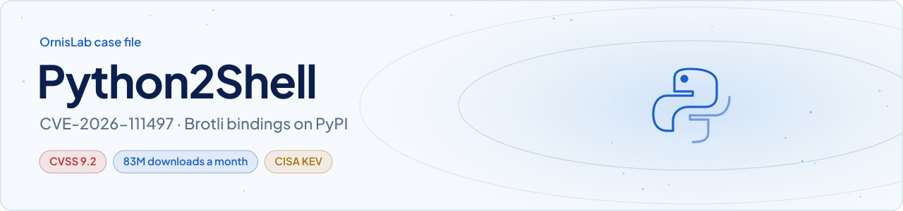
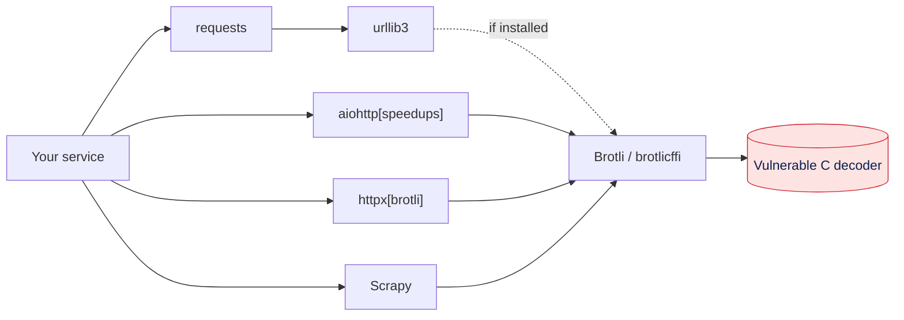
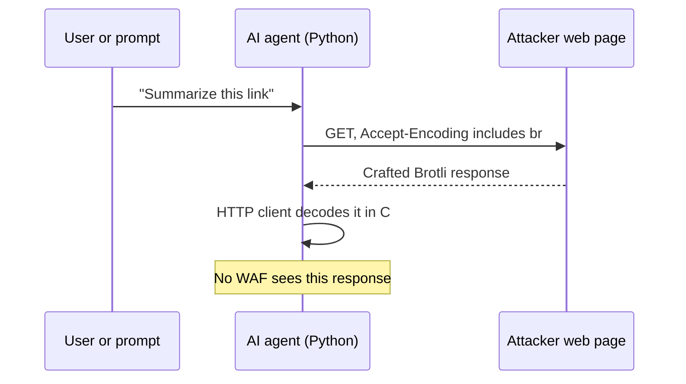

# Python2Shell (CVE-2026-111497)

Python2Shell is the Brotli decoder flaw arriving in Python through dependencies nobody asked for. The PyPI packages `Brotli` and `brotlicffi` wrap the same vulnerable C code that Node.js ships, and the most widely used Python HTTP clients pick them up automatically. Many affected services never import Brotli themselves.

> [!NOTE]
> Root cause and disclosure timeline: [Node2Shell](../node2shell/README.md). Fixed versions across stacks and attack traffic: [HTTP2Shell](../http2shell/README.md). Finding every copy: [Broccoli2Shell](../broccoli2shell/README.md).

## At a glance

| Field | Details |
| :-- | :-- |
| **Advisories** | CVE-2026-111497, GHSA-9v8h-qqgm-4m35, PYSEC-2026-4322 (`Brotli`), PYSEC-2026-4323 (`brotlicffi`) |
| **Vulnerable** | `Brotli` 1.0.3–1.2.0; `brotlicffi` 1.0.3–1.2.0.x |
| **Fixed** | `Brotli` 1.2.1; `brotlicffi` 1.2.1.0 (22 October 2026) |
| **Reach** | `Brotli` is downloaded about 83 million times a month |
| **Python impact confirmed by** | OpenSourceMalware and Aikido |

## How a Python service gets the vulnerable decoder



Python code does not need to import Brotli to be affected. These are the usual ways it ends up installed:

| Library | When it uses Brotli |
| :-- | :-- |
| `urllib3`, `requests` | Automatically, whenever `Brotli` or `brotlicffi` is installed |
| `aiohttp` | When `Brotli` is installed, for example through `aiohttp[speedups]` |
| `httpx` | With the `httpx[brotli]` extra |
| Scrapy | Always; `Brotli` is a hard dependency |

That makes the check different from most CVEs. Asking "does our code use Brotli?" will usually get the wrong answer. Ask whether **any package in the environment** is a Brotli binding.

## Why pure Python does not protect you

The bindings are thin wrappers, and decompression happens in compiled C. A memory bug there corrupts native memory inside the Python process, below the interpreter and its safety checks. Python's memory safety covers Python objects only, not the C extensions loaded into the same process.

## How the impact was confirmed

On 23 October, OpenSourceMalware compared the `Brotli` 1.2.0 and 1.2.1 source distributions. Apart from the version bump, the only change was the decoder fix. The team then built both versions with AddressSanitizer and fed them a crafted stream. 1.2.0 kept consuming the roughly 23 MB stream and kept asking for more input; 1.2.1 rejected it with error −17 every time, however the data was fed in. OpenSourceMalware did not try to get code execution in Python. The decoder code matches the code Imperva exploited in Node.js, though.

The same day, Aikido's Philippe Dourassov posted that "Python2Shell" was "also a thing now", and Aikido extended its coverage to Python.

## Who should worry most



| Workload | Why it is exposed | Priority |
| :-- | :-- | :-- |
| AI agents, RAG ingestion, browsing tools | Fetch attacker-reachable URLs; responses decoded automatically | Highest |
| Crawlers and scrapers (Scrapy) | Fetch untrusted content at scale; Brotli always installed | Highest |
| Webhook senders, link previews, URL importers | Destination supplied by users | High |
| Data pipelines reading Parquet or archives | Brotli-compressed files from partners or uploads | High |
| APIs inflating `br` request bodies | Only if the framework or middleware decodes them | Medium |
| Services with Brotli installed but only internal, trusted traffic | Little attacker-controlled input | Lower |

## Exploitation and forensics

No public report describes a confirmed compromise of a Python service through this flaw. Zscaler's early telemetry included probes shaped for Python task infrastructure (a Celery and decompression-bomb probe) and pointed at ML platforms such as MLflow, Metaflow and Ray Serve as likely targets.

In Python, a failed or partly successful attempt is more likely to show up as a dead worker than as a traceback:

- gunicorn, uvicorn or Celery workers ending with signal 11 and being restarted by the supervisor,
- in Kubernetes, pod restarts with exit code 139,
- after a crash, a worker spawning shells or opening unexpected connections.

Teams that treat worker segfaults as harmless background noise should look again at any recorded since 21 October.

## Detection

```bash
pip show Brotli brotlicffi
pipdeptree -r -p Brotli                  # which package pulled it in
grep -riE "brotli" poetry.lock uv.lock Pipfile.lock requirements*.txt
docker run --rm <image> pip show Brotli brotlicffi
```

> [!WARNING]
> In the first days after disclosure, pip-audit, Dependabot and Safety did not reliably flag affected versions. Verify versions directly instead of relying on a clean scan.

Bindings installed from distribution packages instead of PyPI follow the distribution's advisory.

## Remediation

1. Upgrade: `pip install -U "Brotli>=1.2.1"` or `"brotlicffi>=1.2.1.0"`.
2. Pin the floor in constraints files, regenerate lockfiles, and rebuild images and vendored wheels.
3. Start with the "Highest" rows above.
4. If you cannot upgrade, uninstall the bindings and drop Brotli extras. `requests`, `urllib3` and `httpx` then fall back to gzip and deflate, and the few servers that only speak Brotli will fail.
5. Restrict egress for anything that fetches URLs it does not control.

## OrnisLab assessment

**Optional dependencies count as attack surface.** Python's "use it if installed" pattern means that one install of `aiohttp[speedups]` or Scrapy quietly changes how every HTTP client in the environment decodes responses. Inventories should list what is *installed*, not just what is *declared*.

**AI workloads raise the stakes.** Python dominates agent and retrieval tooling, and those systems are built to fetch arbitrary content from the web. That turns a decoder bug into an attack path that any attacker-controlled web page can trigger. We expect fetch-heavy AI services to be where this CVE is used against Python in practice.

**Scanner coverage lagged.** For several days, dependency scanners missed affected versions. For critical CVEs in native extensions, check versions directly instead of waiting for scanner databases to catch up.
