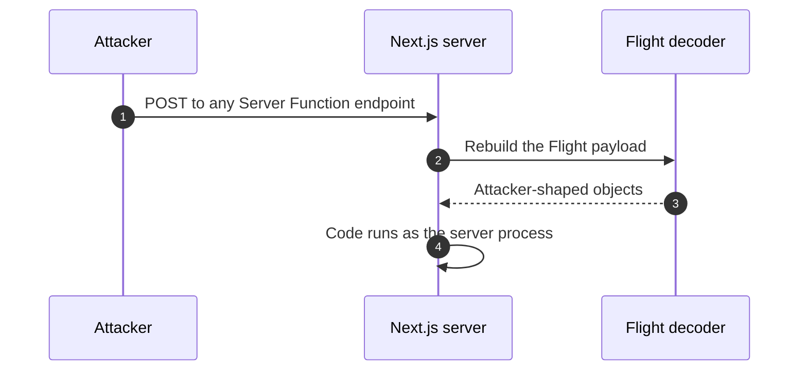
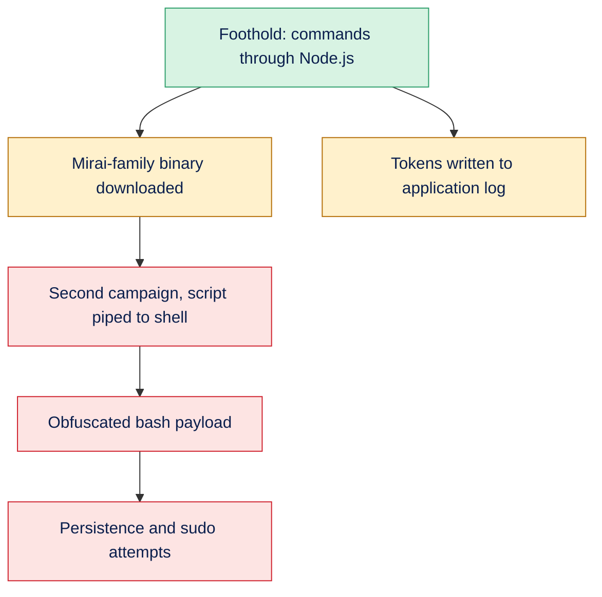

# React2Shell (CVE-2025-55182)

A single crafted HTTP request to a React Server Components application could run code on the server, with no login and no application bug required. React2Shell was the first of the "2Shell" incidents and set the pattern for the rest: a framework internal, exposed by default, weaponized the same day.

## At a glance

| Field | Details |
| :-- | :-- |
| **CVE** | CVE-2025-55182; Next.js tracked as CVE-2025-66478 |
| **Severity** | CVSS 10.0 |
| **Weakness** | CWE-502, deserialization of untrusted data |
| **Vulnerable** | `react-server-dom-webpack`, `-parcel`, `-turbopack` 19.0, 19.1.0, 19.1.1, 19.2.0 |
| **Fixed** | 19.0.1, 19.1.2, 19.2.1 |
| **Frameworks** | Next.js, React Router (RSC APIs), Waku, `@parcel/rsc`, `@vitejs/plugin-rsc`, RedwoodSDK |
| **Credit** | Lachlan Davidson |
| **Exploited** | Yes; CISA KEV on 5 December 2025 |

## Root cause



Server Functions turn a browser-side call into an HTTP request and back into a function call on the server. React does this with "Flight", an internal wire format that was never documented as a public interface. The server trusted the structure of incoming Flight data while rebuilding it, and a crafted payload could steer that rebuilding into executing attacker-chosen code.

Two details widened the exposure:

- **The entry point exists even if you never wrote a Server Function.** Supporting React Server Components was enough.
- **Next.js exposes it publicly by default.** Any route that exports a Server Function accepts Flight payloads from the internet.

Purely client-side React apps, and React apps without a server-components framework or bundler, were never affected.

## Discovery and disclosure

Davidson found the flaw by reverse-engineering the undocumented Flight format and reported it through Meta's bug bounty program. Disclosure was well coordinated: hosting providers had temporary protections before the CVE went public.

| Date | Event |
| :-- | :-- |
| 29 Nov 2025 | Reported to Meta |
| 30 Nov 2025 | Confirmed; React team starts the fix |
| 1 Dec 2025 | Fix ready; hosting providers and frameworks prepare mitigations |
| 3 Dec 2025 | Patched packages and CVE published |
| 3 Dec 2025, within hours | First exploitation attempts recorded by Amazon |
| 4–5 Dec 2025 | Working public exploits; Davidson releases his originals; Metasploit module; CISA KEV |
| 11 Dec 2025 | Follow-up fixes: CVE-2025-55183 (source exposure), CVE-2025-55184 and CVE-2025-67779 (denial of service) |
| 26 Jan 2026 | Further denial-of-service fix, CVE-2026-23864 |

A wave of fake proof-of-concept repositories followed the disclosure. For defenders this mattered: testing with a fake PoC produced false "not vulnerable" results.

## Exploitation

Amazon's honeypots recorded attempts within hours of disclosure from infrastructure it associates with China-nexus groups **Earth Lamia** (known for web-application exploitation in Latin America, the Middle East and Southeast Asia) and **Jackpot Panda** (focused on East and Southeast Asia, particularly the online gambling sector). Amazon noted that the attackers fired whatever exploit they had at every target, accuracy be damned, and that shared anonymization networks make attribution uncertain. Within weeks the exploit was part of commodity botnet toolkits, and scanning has not stopped since.

## Forensic findings



Green: worked. Amber: partial. Red: failed.

Hunt.io's reconstruction of an attack on a production Next.js application, beginning on 8 December 2025 and covering about 12,400 log lines, is the most detailed public post-compromise record for any of the 2Shell incidents. Our reading of the attack chain:

| Phase | What the attacker tried | Result |
| :-- | :-- | :-- |
| Foothold | Ran shell commands through the Node.js process | Worked |
| Botnet install | Pulled a Mirai-family binary into a temp directory | Downloaded, never ran |
| Second campaign | Hid a binary in a device directory; streamed a script directly into a shell | Mostly failed |
| Obfuscation | Base64 script that fetches over bash's built-in networking | Failed: no bash in the container |
| Persistence | Keepalive script with a watchdog; nine sudo attempts | Failed: no sudo, scripts could not run |
| Collateral | Session tokens ended up in the application log | Exposure confirmed; tampering unproven |

Volume: about 1,084 command attempts, a single campaign tag repeated 541 times, and roughly 544 connections to the main command-and-control server.

**What this case tells defenders**

- **RCE was not the end of the story.** The attacker had code execution and still achieved almost nothing, because the image had no bash, curl or sudo and long-running processes were killed. Container minimalism is a security control, not just a size optimization.
- **Failures are loud.** Hundreds of timeouts, syntax errors and sudo failures were all visible in logs. Alerting on failed command execution from a web process would have caught this attack early.
- **Logs became a leak.** Tokens written into application logs turn log storage into a target. Treat logs from a compromised service as sensitive.

**ATT&CK techniques observed:** T1190, T1059.004, T1105, T1027, T1037, T1548.003, T1071.001, T1565.001.

**Infrastructure (defanged).** From Hunt.io: 176.117.107[.]154, 193.34.213[.]150, 78.153.140[.]16, 128.199.194[.]97:9001. From Amazon: 206.237.3[.]150 (Earth Lamia), 45.77.33[.]136 (Jackpot Panda).

**Endpoint signature.** In Packetwatch's lab reproduction on Windows, `node.exe` spawned `cmd.exe`. On Linux, look for the Node.js server spawning `sh`, `bash`, `curl` or `wget`.

## Detection

```bash
npm ls react-server-dom-webpack react-server-dom-parcel react-server-dom-turbopack next
```

Run the check against lockfiles and container images, not only live hosts.

High-signal hunts:

1. Web-server Node.js processes with child shells or download tools.
2. Bursts of failed commands or timeouts from the web process.
3. New files in `/tmp`, `/dev/shm` or device directories.
4. First-seen outbound destinations from front-end servers.
5. Secrets or tokens appearing in application logs.

## Remediation

1. Upgrade `react-server-dom-*` (19.0.1, 19.1.2, 19.2.1 or later) together with `react` and `react-dom`; take the patched Next.js release for your line.
2. Apply the December 2025 and January 2026 follow-up fixes.
3. Rotate every secret available to a server that ran a vulnerable build while reachable.
4. Strip shells, download tools and privilege-escalation binaries from production images; enforce process time limits.
5. Treat provider WAF rules as a bridge to patching, never as the fix.

## OrnisLab assessment

React2Shell shows that **internal protocols are attack surface even when undocumented**. Flight was never meant to be a public interface, yet every Next.js deployment exposed it to the internet. Teams should list the framework endpoints they expose, not only the routes they wrote.

The incident also showed how hard early triage is. Fake PoCs, overlapping CVE numbers for React and Next.js, and follow-up CVEs a week later all slowed down the basic question of "are we exposed?". Our recommendation is to answer that question from dependency data (lockfiles and SBOMs) rather than from external scanning or public PoCs.

Finally, the forensic record favours defense in depth over speed alone. Patching within hours was not realistic for many teams; a hardened runtime image was already in place before disclosure and decided the outcome.
